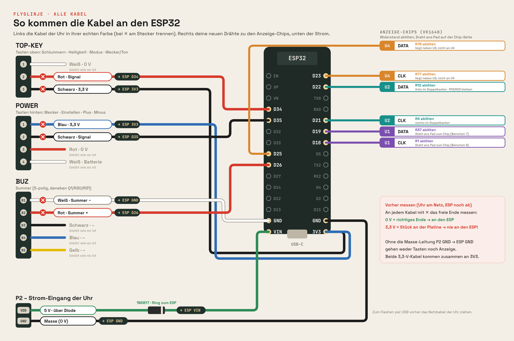

# FLYGLINJE

FLYGLINJE – A DIY ESP32-powered project. Built with curiosity, questionable engineering decisions, and absolutely no guarantee that everything works as intended.

FLYGLINJE turns the IKEA **KORTLINJE** alarm clock into a **live flight tracker** – without giving up what the clock already does. An ESP32 takes over the three display drivers, the buttons and the buzzer. Everything is set up in the browser; firmware updates arrive over the air.

> **Status:** work in progress, built as a birthday present. Runs on real hardware, but expect rough edges.
> Current firmware: **v0.8.5 „Quartett“** · Model FL-0340 · by [Pixel & Propeller](https://bastelbyra.de)
> Build guide and full release notes (German): [bastelbyra.de/umbau](https://bastelbyra.de/umbau/) · [bastelbyra.de/firmware](https://bastelbyra.de/firmware/)

---

## What it does

**Flights**
- Flights within an adjustable radius: flight number, route, altitude, distance, type and heading on the 42 × 9 dot matrix
- Special aircraft get their own page – emergencies, radio failure, rescue flights, military, A380, Jumbo, Beluga …
- „Über dir!“ when a plane passes almost straight overhead
- Track a single flight anywhere in the world and get a sound when it lands
- Flight statistics: today, yesterday, total, records

**Collecting & playing**
- Collection album with 176 aircraft types, 87 airlines and every airport seen – five rarity levels, silver and gold cards, photos and facts
- 28 badges to unlock
- Snake, Pong and an aircraft top-trumps game („Quartett“) for two – the phone is the controller

**Clock**
- Two alarms with weekdays, snooze per alarm, wake-up light, weather after the alarm
- Day and night profile (switch by time or sunset), brightness 1–8
- Weather mode, severe-weather warnings (DWD), ISS passes computed on the clock itself (SGP4)
- Kitchen timer, special days with countdown, birthday song

**Under the hood**
- Web interface for setup and all settings, reachable only from the home network
- Over-the-air updates from bastelbyra.de with automatic rollback
- Encrypted secrets (AES-256-GCM), PBKDF2 login, random setup password per clock, growing lockout after wrong passwords
- Reboot diagnostics: reason and place of the last crash
- Settings backup and restore as a file

## Build it yourself

The firmware is a plain Arduino sketch without extra libraries: [firmware/README.md](firmware/README.md).

## Hardware

| Part | Notes |
|---|---|
| IKEA KORTLINJE alarm clock | the donor |
| ESP32 DevKit (30 pin, ESP-WROOM-32, CH340) | USB-C version recommended |
| Schottky diode 1N5817 | between clock 5 V and ESP `VIN` |
| Thin wire, pin headers, Dupont cables | headers make the ESP removable |
| *optional:* AHT20 / SHT30, DS3231 | temperature/humidity, real-time clock via I²C |



Details: **[docs/wiring.md](docs/wiring.md)**

## Quick start

1. **Flash first, solder later.** Put the firmware on the bare ESP32 before it goes into the clock: download `flyglinje-vX.Y.Z-komplett.bin` from the [latest release](../../releases/latest) and write it to address `0x0` – see [docs/flashing.md](docs/flashing.md).
2. **Rebuild the clock** following [docs/wiring.md](docs/wiring.md) (photo guide on [bastelbyra.de/umbau](https://bastelbyra.de/umbau/)).
3. **Set up:** join the Wi-Fi `FLYGLINJE-xxxx` – the random password scrolls across the display. The setup page opens by itself (or `http://192.168.4.1`). Afterwards the clock is at `http://flyglinje.local`, login `admin` / `admin` until you change it.

From then on updates are installed from the web interface (System › Update).

## Repository layout

```
firmware/   ESP32 firmware (Arduino sketch, web interface, build tools)
docs/       wiring, flashing, release process
hardware/   wiring graphics
tools/      helper scripts (changelog from the website)
```

## Safety

You are opening a mains-powered device and soldering on its board. Unplug it before working on it, measure every wire before switching on, and never connect USB to the ESP while the clock is powered without the diode in `VIN`. You do this at your own risk.

## Credits & data

FLYGLINJE stands on the work of others – fellow tinkerers who opened the KORTLINJE first, and open data services from ADS-B volunteers to OpenStreetMap. Full list: **[CREDITS.md](CREDITS.md)**.

## License

[MIT](LICENSE) for the code and documentation in this repository. Third-party data and material keep their own licenses, see [CREDITS.md](CREDITS.md).

FLYGLINJE is a private hobby project and not affiliated with or endorsed by IKEA. IKEA and KORTLINJE are trademarks of Inter IKEA Systems B.V.
